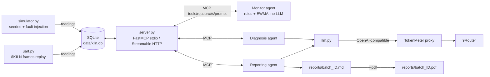
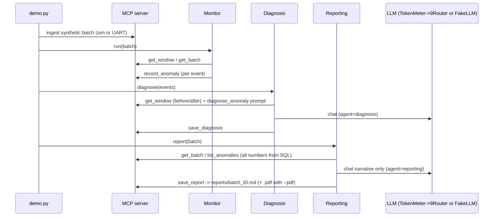

# KilnMCP (MVP, M0-M3)

> **ALL DATA IS SAMPLE/SYNTHETIC.** No real kiln and no real plant data are involved. Every API response carries `"synthetic": true`, and every batch report is labelled **"dMRV-style DRAFT - NOT CERTIFIED"**.

KilnMCP is an MCP server (FastMCP, Python `mcp` SDK 1.x) that serves *synthetic* biochar pyrolysis kiln telemetry. Three plain-Python agents use it:

- **Monitor**: rules plus EWMA/k-sigma, no LLM. It finds anomalies and records them with `record_anomaly`.
- **Diagnosis**: an LLM explains each incident using MCP tool results (`get_window` stats before and after the incident) and the `diagnose_anomaly` prompt.
- **Reporting**: writes a templated Markdown batch report. All numbers come from SQLite through MCP tools. The LLM writes only the narrative.

## Architecture




## Layout
```
kilnmcp/simulator.py  seeded simulator + fault injection (air_leak, wet_feedstock, temp_sensor_stuck) -> SQLite
kilnmcp/uart.py       UART byte-stream frames ($KILN,...*XOR), file/serial replay (pyserial; socat pty works)
kilnmcp/server.py     FastMCP server: stdio or Streamable HTTP (127.0.0.1)
kilnmcp/agents.py     monitor / diagnosis / reporting agents (MCP ClientSession)
kilnmcp/llm.py        OpenAI-compatible client (TokenMeter -> 9Router) + FakeLLM
kilnmcp/demo.py       end-to-end CLI demo (supports --profile lampung_coffee_corncob)
kilnmcp/pdf.py        Markdown report -> PDF (markdown + xhtml2pdf, pure Python)
kilnmcp/workbench.py  PT ENVIID Karbon Solusi × KilnMCP Lampung Pyrolysis & Batch dMRV Workbench generator
web/index.html        interactive dual-canvas telemetry, UART inspector & QR bag reconciliation workbench
scripts/record_demo.ps1 / replay_demo.ps1  text "terminal recording" of the mock demo
config/thresholds.yaml  editable thresholds (also served as kiln://thresholds)
```

## MCP surface
- **Tools:** `get_latest`, `get_window`, `get_batch`, `list_batches`, `list_anomalies`, `log_event`, `record_anomaly`, `save_diagnosis`, `save_report`, `get_lampung_dmrv`
- **Resources:** `kiln://batches/{id}`, `kiln://thresholds`, `kiln://schema`, `kiln://profiles/lampung_coffee_corncob`
- **Prompt:** `diagnose_anomaly`

## Setup (Windows PowerShell)
```powershell
cd C:\Users\ardhy\projects\kilnmcp
python -m venv .venv
.\.venv\Scripts\pip install -r requirements.txt
.\.venv\Scripts\python -m pytest -q
```

## Run
```powershell
# Full demo with an injected air leak, using the real LLM through the TokenMeter proxy (project=kilnmcp)
.\.venv\Scripts\python -m kilnmcp.demo
# Other options
.\.venv\Scripts\python -m kilnmcp.demo --mock-llm                    # offline
.\.venv\Scripts\python -m kilnmcp.demo --mock-llm --pdf              # also write reports\batch_SYN-0001.pdf
.\.venv\Scripts\python -m kilnmcp.pdf reports\batch_SYN-0001.md      # PDF from an existing report (no LLM call)
.\.venv\Scripts\python -m kilnmcp.demo --fault wet_feedstock@50+8 --batch SYN-0002
.\.venv\Scripts\python -m kilnmcp.demo --uart                        # ingest via UART frame replay
# MCP server on its own
.\.venv\Scripts\python -m kilnmcp.server                             # stdio (MCP Inspector: npx @modelcontextprotocol/inspector)
.\.venv\Scripts\python -m kilnmcp.server --transport streamable-http --port 8765   # http://127.0.0.1:8765/mcp
.\.venv\Scripts\python -m kilnmcp.demo --http http://127.0.0.1:8765/mcp
# UART tooling
.\.venv\Scripts\python -m kilnmcp.uart write data\b.frames --fault air_leak@60+6
.\.venv\Scripts\python -m kilnmcp.uart replay --file data\b.frames   # or --port COM5 / /dev/pts/N (socat)
# PT ENVIID Karbon Solusi Lampung Profile & Interactive Workbench
.\.venv\Scripts\python -m kilnmcp.demo --profile lampung_coffee_corncob --mock-llm
.\.venv\Scripts\python -m kilnmcp.workbench --out web\index.html
```

## Sample output (excerpt, `--mock-llm`, synthetic)
```text
[ingest] simulator: 2884 readings
[banner] SAMPLE/SYNTHETIC DATA - not from a real kiln | LLM=fake/mock-llm @ mock://
[monitor] R-EWMA-o2_pct    o2_pct        peak=9.341    thr=0.853 samples=37
[monitor] R-EWMA-temp_c    temp_c        peak=452.2    thr=14.775 samples=38
[monitor] R-O2-HIGH        o2_pct        peak=9.341    thr=5.0 samples=33
[monitor] R-TEMP-LOW       temp_c        peak=452.2    thr=500 samples=30
[diagnosis] R-O2-HIGH: cause=air_leak :: [MOCK] Pattern consistent with air_leak based on the supplied windows.
[report] reports\batch_SYN-0001.md  (dMRV-style DRAFT - NOT CERTIFIED)
[report] reports\batch_SYN-0001.pdf
```
Report excerpt (`reports/batch_SYN-0001.md`, real-LLM run):

| # | rule | sensor | samples | peak | threshold | severity |
|---|---|---|---|---|---|---|
| 3 | R-O2-HIGH | o2_pct | 33 | 9.34 | 5.0 | high |
| 4 | R-TEMP-LOW | temp_c | 30 | 452.20 | 500.0 | high |

Artifacts: `reports/batch_SYN-0001.md`, `reports/batch_SYN-0001.pdf`, `reports/run_SYN-0001.json`, full mock run log in `docs/demo_mock_output.txt`.

## Demo recording
No screen recorder (ffmpeg/asciinema) is assumed. `scripts\record_demo.ps1` runs the mock demo and writes a timestamped
text recording to `docs/demo_recording.txt`; `scripts\replay_demo.ps1` plays it back in a terminal with the original timing.

## Synthetic-data disclaimer
Everything in this repo (telemetry, faults, anomalies, reports, PDFs) is **generated sample data**. It does not describe any real
kiln, plant, operator or batch and must not be used for MRV, certification, carbon credits or engineering decisions.

## Environment variables
| Variable | Default |
|---|---|
| `KILNMCP_LLM_BASE_URL` | `http://127.0.0.1:8787/p/kilnmcp/v1` |
| `KILNMCP_MODEL` | `xai/grok-code-fast-1` |
| `NINEROUTER_API_KEY` | Optional. If it is set, it is sent as `Authorization`. If not, the TokenMeter proxy uses its fallback. It is never printed or logged. |
| `KILNMCP_DB` | `data/kiln.db` |

LLM calls carry the headers `X-TokenMeter-Tag: kilnmcp` and `X-TokenMeter-Tags: agent=<diagnosis|reporting>`, so TokenMeter can break down cost per agent.

## Fault spec
`kind@start_min+duration_min[xmagnitude]`, for example `air_leak@60+6`. Several `--fault` flags can be combined.

## Caveats
- The simulator produces illustrative shapes. It is not calibrated to pyrolysis physics.
- The thresholds are demo values, not engineering guidance.
- No carbon or MRV math is done.
- LLM text is unverified.
